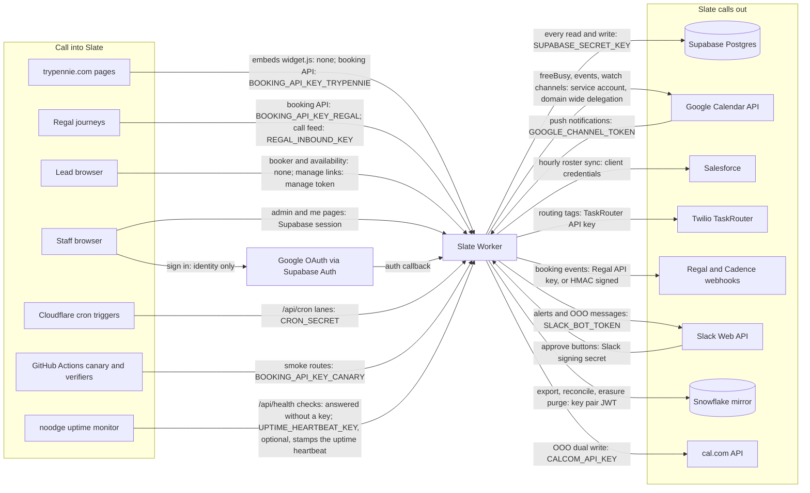
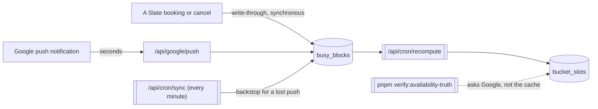

# Slate architecture at a glance

Two coarse diagrams, because the moving parts are hard to hold in your head from the
code alone: a booking touches a cache, Google, Postgres, an outbox and a webhook
subscriber, and the freshness of what a lead sees comes from three different writers.

Deeper detail lives in "The availability rules in full" below (moved from
`CLAUDE.md`), `AGENTS.md` (the rules that bite),
`docs/crash-safe-booking-mutations.md` (the durable-intent pattern) and
`docs/adr/` (the decisions).

## System context: everything Slate talks to

Every external system, with the direction of each call and the credential that
authenticates it (#3131). An arrow points from the caller to the system called, so
an arrow INTO Slate is a route somebody else can reach, and its credential is one of
the rows in `docs/api.md`, ["Credentials and auth models"](./api.md#credentials-and-auth-models).
An arrow OUT of Slate is a credential Slate holds as a Worker secret (DEPLOY.md
section 2b).

Three things the picture does not say, so nobody reads them into it:

- **Calendar access is never the staff member's own Google sign in.** Sign in asks
  for identity only; every calendar read and write is the service account
  impersonating the agent through domain wide delegation (#1046).
- **Regal is on both sides.** Its journeys call Slate's booking API with Regal's own
  key, and Slate posts booking events to Regal's webhook endpoint with a different
  credential held on the `webhook_endpoints` row.
- **The cal.com arrow retires at cutover (#65).** It exists for the out of office
  dual write while both systems are live.

## Booking and availability

The read path is deliberately free of Google. The one live Google call a lead's
request makes is at confirm, which is what turns a stale cache into a slower booking
rather than a double booking (ADR 0003).

The three gates a bookable time must pass, in one shared predicate, are the org's
business hours, then the agent's working hours, then their calendar. The org window
is applied at READ time as well, so narrowing the hours lands on the next request
rather than the next recompute.

A fourth gate belongs to the LEAD, not the availability (#2310): a call may only start
from 08:00 to before 20:00 in the lead's own zone. It is judged in that zone, never
intersected with the org or agent windows, and it is not in the shared cache, because
every lead reads the same cached list. The shared slot picker filters what it shows,
and the booking layer refuses an outside start at confirm and on every reschedule.

## Keeping the cache fresh, and the lanes that do it

Three writers keep `busy_blocks` and `bucket_slots` current, and they are layered on
purpose: the fast one is not trusted to be reliable, and the reliable one is not fast.

The every-minute trigger drives four lanes (`sync`, `recompute`, `outbox`,
`selfheal`). Since #3693 each one is sent over the Worker's binding to itself and runs
as its own placed invocation near the database (an explicit placement hint pinned to
the database's region, `aws:us-west-2`, not Smart Placement, which never moved them),
because placement never moves a `scheduled()` handler; a lane that falls back runs in process and shares the cron's
invocation, which is why per-lane subrequest cost still matters. The
full lane list is in `docs/api.md`, and the platform ceilings are in
`docs/cloudflare-platform-notes.md`.

A lane sent twice for one tick runs once (#4222). Every scheduled lane's first awaited
call claims `(tick id, lane)` in `lane_runs`, whose primary key lets exactly one
delivery through; any other delivery of that tick's lane answers 200 with
`x-slate-lane-not-run: duplicate` and does nothing. A lane that crashed after claiming is
not re-run by a re-send of that tick; the next tick runs it. This is what lets the relay
of #4189 fall back to today's route rather than skip a run. A request with no tick id (a
hand run with the cron secret) runs unclaimed.

When a claim cannot be read (the table missing, locked or slow), the table must not
become a single point of failure for every lane, so (Dan decided 2026-10-26: run anyway,
one alert):
- a FIRST delivery runs anyway, unprotected, and logs `lane claim unreadable, running
  anyway` on the lane's line;
- a RE-SEND, marked `x-slate-lane-resend` by the dispatcher (from #4189's phase 4; nothing
  re-sends yet), runs nothing and answers 503 `claim_unreadable`, because it is the one
  delivery that could run a lane twice;
- one alert, `lane_claim_unreadable`, is raised by the monitor lane from its own claim
  and cleared by its next claim that is written. The lanes never send it, so 28 lanes
  failing in one minute is one page: one judge every five minutes under its lease, one
  key, and a condition that repeats once a day (`src/lib/monitor/lane-claim-health.ts`).

Rules: `src/lib/monitor/lane-claim.ts`; every scheduled route claiming first:
`scripts/test-lane-claim-coverage.ts`; the constraint in a real Postgres:
`scripts/verify-lane-runs-sql.ts`. Claims are kept two days, pruned by the
`prune-regal-calls` lane.

Every lane stamps a heartbeat, and a watchdog pages when one goes quiet, because a
lane that has stopped running looks exactly like a lane with nothing to do. Three
detectors carry a second stamp for when they last reached a MEASURED verdict, since a
fail-safe detector that reports "could not check" renders identically to one finding
nothing wrong (#1394).

## The availability rules in full

Moved out of `CLAUDE.md` on 2026-10-15 (#2393). `CLAUDE.md` keeps a short form
of each rule; this is the text as it stood, with the history behind it.

- **Availability is cache-first.** `busy_blocks` is the cached index: Slate
  bookings write through synchronously; Google push (`/api/google/push`) +
  the 1-min `/api/cron/sync` backstop keep external changes fresh. The embed
  reads the cache via `/api/availability`, never live Google. The recompute lane
  computes once per POOL rather than once per bucket code (#2245: 60 codes, 15
  pools) and writes every code in the pool its own row, each keeping its own
  bucket identity; see "One availability compute per POOL" below before changing
  what feeds the compute. The only
  live Google call on the hot path is verify-on-book at confirm time
  (`src/lib/booking/service.ts`): it checks the round-robin candidates in batched
  waves (one Google call per wave, #167) and takes the first actually-free agent.
- **A bookable time passes three availability gates, in one shared predicate.**
  `bookableSlotReason` (`src/lib/availability/compute.ts`) is the only judge: the
  ORG's business hours (#1295), then the AGENT's working hours, then their
  calendar. The org window comes from `business_hours` via `loadBusinessHours`,
  which THROWS on an unreadable week rather than degrading, because serving
  unfiltered hours would silently re-open a narrowing and look like a healthy day.
  The two hour windows are each judged in their OWN zone and never intersected:
  clipping is correct only for an agent in the business zone. **The roster is NOT
  all Eastern** (#1739, corrected 2026-09-02): it spans seven zones, 27 in Phoenix
  and 16 in Los Angeles among them, so production data now CAN tell the two apart
  and a mistake here is visible rather than theoretical. It used to read "every
  live agent is Eastern, so no production data can tell the two apart", which was
  true of the stored data and false about the world: every schedule said
  `America/New_York` because that was the seeded default nobody had edited.
  `scripts/test-availability-zones.ts`
  (#1316) is what does tell them apart: it drives a Pacific, a Tokyo and a London
  agent at instants where the correct answer and minute-clipping DISAGREE, including
  the org's day spanning two of the agent's local weekdays and the three weeks a year
  when only one of two zones has changed its clocks. Breaking the gates either
  plausible way (judging the agent in the org's zone, or intersecting the windows)
  makes it fail.
  `businessHours` is REQUIRED on `SlotRules` / `SlotComputeInput` so `tsc`
  enumerates every construction site.
- **A fourth gate is the LEAD's calling window** (#2310): a call may only start
  from 08:00 to before 20:00 in the lead's zone (the booker's zone, or the
  booking's own on an admin move), because Regal's quiet hours journey cancels
  anything else. It is judged in the lead's zone, separately from the org and
  agent windows and never intersected with them, by one predicate
  (`src/lib/booking/lead-calling-window.ts`). It is NOT in
  `bookableSlotReason` or the slot cache, which is shared by every lead: the
  shared picker (`pickerSlots`) filters the served list, and `createBooking` /
  `rescheduleBooking` refuse with `OutsideCallingWindowError` before any write.
- **The org window is ALSO applied at read time** (#1296), because a slot computed
  under a wider window can still be sitting in the slot cache after a narrowing.
  `resolveBucketSlots` filters every tier (cache hit, stored row, cold compute)
  through `slotsWithinBusinessHours`, so an edit lands on the next request rather
  than the next recompute. The cache keeps the UNFILTERED payload so re-opening a
  day is just as immediate as closing one. The hours come from
  `loadBusinessHoursCached`, one read per isolate per `BUSINESS_HOURS_TTL_MS`
  (pinned equal to `SLOT_TTL_SECONDS` by `scripts/test-business-hours-ttl.ts`); a
  failed refresh serves the LAST KNOWN week rather than failing the request, which
  stays honest because a sustained failure stops recompute writing and
  `bucket_slots_stale` pages. Consequence: the stored row and the served response
  may disagree for up to one recompute cycle, deliberately. Mass invalidation was
  rejected because marking 60+ buckets stale can page a false stale alarm.
  Anything counting cached slots must use the same filter, which is why
  `slotHealthByCode` takes the hours and returns `null` (not 0) for a count it
  could not measure.
- **Server code uses the secret-key client** (`supabaseAdmin`, bypasses RLS; the
  new-style `sb_secret_…` key; anon/service_role JWTs are legacy).
  RLS is default-deny; the only client-readable row is a user reading itself.
- **DB types are hand-written** (`src/lib/db/types.ts` + `schema.ts`). Regenerate
  with `supabase gen types typescript` once a project is linked.
- Weekday convention is Luxon's (1=Mon..7=Sun).

## Three ways a Google calendar can fail, not two

Moved out of `AGENTS.md` on 2026-10-15, where every character was loaded into
every session (#2393). `AGENTS.md` keeps the rule and points here; this is the
full text as it stood, with the reasoning, the incidents and the measurements
behind it.

A failed calendar read is classified `gone`, `not-provisioned`, or `transient`
(`src/lib/google/reachability-classify.ts`), and the distinction decides what a
message tells the reader to DO:

- **gone** (a 4xx: account removed from the Workspace, delegation revoked, calendar
  not found) is a credential or membership repair: re-auth, or take them out of the
  pool.
- **not-provisioned** (`403 notACalendarUser`, #1396) is an account that has never
  been given Calendar at all. Retrying can never fix it and nothing is wrong with
  the credentials; a Workspace admin has to give the person Calendar. At least one
  real agent is in this state, and new hires reaching Slate before their Google
  provisioning completes make it the expected direction of travel.
- **transient** (5xx, timeout, rate limit) usually self-heals.

**Never branch on `kind === "gone"`.** Use `isDefinitiveFailure`
(`src/lib/google/sync-health.ts`, kept there so the every-minute sync coalescer can
reach it without pulling a Google dependency behind it). A literal comparison
treats `not-provisioned` as transient, which fails OPEN: the rotation retries a
hopeless account every minute on a shared budget, and the activation gate refuses
it with "retry shortly", advice that can never work. A null kind is definitive too,
matching #916, so an unclassified streak never goes quiet.

Adding a fourth kind means giving it its own label AND its own instruction;
`scripts/test-google-not-provisioned.ts` drives that off the list of kinds and
fails when two share either.

## The placeholder advisor path (milestone 75)

A scheduling coordinator on the phone books whatever time the customer names, through
`placeBooking` (`src/lib/booking/placed-booking.ts`). Every rule a lead's booking keeps
still holds there: the go live switch, Pennie's business hours, the customer's calling
window in the zone their Lead gives, the horizon, nothing in the past.

1. **A real advisor first.** The ordinary create (slot predicate, verify on book, the
   confirm line) books a free advisor in the customer's bucket, as a `routed` booking
   with source `coordinator`. Only its refusal for want of a free advisor falls through;
   an outage is reported as itself, never parked on the placeholder.
2. **Then the placeholder.** One placeholder advisor per org and world
   (`users.is_placeholder`, migration 0207, unique on `org_id, is_test`, so a test
   bucket's call lands on the test placeholder and never the real one). It is Marcia,
   Pennie's AI agent. The call is booking kind `staff_placed` and stacks with any number
   of others at that time (`allow_double_book`). A CHECK keeps the placeholder never
   bookable, so no public booking can be routed to it, and the shared real advisor rule
   (`src/lib/advisors/real-advisor.ts`) keeps it off every advisor screen, picker, pool,
   sync and advisor monitor. Its BOOKINGS are real calls and stay wherever bookings are.
3. **The kind follows the assignee** (migration 0208). The trigger
   `bookings_kind_follows_assignee` refuses a booking on the placeholder that is not
   `staff_placed` and stacking, refuses `staff_placed` on a real advisor at insert, and
   turns a `staff_placed` booking `routed` when any path (a lead's reschedule, a
   reassign, coverage, a bulk sweep) moves it onto a real advisor. A move ONTO the
   placeholder goes through `commit_reschedule_onto_placeholder`, which writes the kind
   and the stack flag that `commit_reschedule` deliberately clears (0206).
4. **One call per customer**, matched on the Salesforce Lead id alone. An existing call
   is shown, and moved (the same booking and manage link) only once the coordinator
   confirms; a match on email or phone only is shown and refused.
5. **The switch.** `booking_settings.placeholder_booking_enabled` (0207), false by
   default. Off, nothing is placed on the placeholder; an unreadable switch is refused,
   never read as on.

**What happens at the call's time.** Nobody dials as the placeholder. Every Regal
journey on Slate's events branches on `slateGhostBooking` (#4204, docs/api.md) and sends
the call straight to the pool, and Marcia texts the customer. The placeholder's own
Google seat sends the invite and the 24 hour reminder from its Calendar and Gmail, and
its inbox is a no reply mailbox with a standing auto reply that tells customers to text
Pennie. A coordinator moves or cancels a call from the manage link Regal copies into the
Lead's `calBookingLink__c`.

**What watches it** (#4206, all in the monitor lane, runbook "A call on the placeholder
advisor is at risk"):

- `placeholder_call_unserved:<booking>`: a call 15 minutes past its booked END with no
  Regal call to the customer's Lead in `regal_call_outcomes` since 15 minutes before its
  start, judged only once the call feed has received anybody's call after that time
  (`src/lib/monitor/placeholder-calls.ts`). The match is on the Lead id because the feed
  stores no phone. The grace runs from the end, not the start, because Slate hears of a
  call only when it completes.
- `placeholder_seat_failing`: the seat's Calendar (`calendarList.list`) or Gmail (a
  `gmail.send` token mint) failing while the seat is in use, classified with
  `isDefinitiveFailure` (`src/lib/monitor/placeholder-seat.ts`). The vacation responder
  is NOT checked: reading it needs `gmail.settings.basic`, which Slate does not hold.
- `placeholder_missing`: the switch on with no usable placeholder (no row, deactivated,
  or no address).

## One availability compute per POOL, not per bucket code (#2245)

Moved out of `AGENTS.md` on 2026-10-15, where every character was loaded into
every session (#2393). `AGENTS.md` keeps the rule and points here; this is the
full text as it stood, with the reasoning, the incidents and the measurements
behind it.

Sixty bucket codes resolve to **fifteen** distinct pools, measured against
production on 2026-09-11. The legal digit stopped routing (#2218) and backend
digits 0 (None) and 1 (Both) never set `backend_service` at all, so six codes per
tier carry identical criteria. The every minute recompute lane was running the
whole multi agent availability compute sixty times to produce fifteen answers, on
the lane whose headroom already pages (#2021).

The lane now groups before it dispatches (`groupByPool`, `poolsDueForRecompute`,
`recomputePool`), computes once per pool, and writes **every code in that pool its
own row**. Three things about that are load bearing:

- **`bucket_slots` still holds one row per code and each row keeps its OWN bucket
  identity.** The stored payload is read back for the routing trace's effective
  code, the test bucket gate and the empty bucket alert key, so a shared row
  would have five codes reporting a sixth's bucket. Collapsing the table to
  fifteen rows was weighed and DEFERRED (Dan, 2026-09-11): it needs a bucket
  lookup back on the booker's hot path and moves four monitors into pool space,
  for a saving of forty five small writes. Do not do it without re-reading #2245.
- **Freshness is asked of the POOL, never of each code.** The jitter (#1247)
  gives every code its own deadline inside the window, so a pool has six; writing
  all six rows at the first of them resets the clock into the next deadline a
  minute later, and the lane would recompute a pool roughly every quarter window.
  `scripts/test-pool-due.ts` drives three windows a minute at a time and catches
  exactly that: the naive version refreshes nine times where the correct one
  refreshes three.
- **A pool's rows are stamped from the OLDEST input the compute used** (#3388).
  The lane alone reads eligibility through the 60 second cache, and a cached list
  is as old as its read. So `recomputePool` stamps `computed_at` with the earlier
  of its own start and that read (`readEligibleCached` records it with the entry,
  `trackEligibleReads` hands the compute the oldest), and the #1048 gate lets a
  row a live path wrote after the read stand. Every live path reads eligibility
  during the compute and stamps from its start, as before. The row ALSO records when
  its compute started (`compute_started_at`, migration 0202), and the two times
  answer different questions (`src/lib/availability/slot-row-times.ts`):
  - the stamp is the data's age: the write gate, the empty bucket check, the
    `x-slots-computed-at` header, the offer race judge and the below tier notice
    check read it;
  - the start schedules the lane: the due set, the stale alarm and the admin "Last
    computed" column read it through `scheduleAnchorMs`, because judged by the
    stamp a pool moved back past its grid point in `bucketDueAtMs` came due again a
    tick later (16% to 80% more computes, simulated in
    `scripts/test-recompute-due-from-start.ts`). The anchor takes the start only
    when the stamp can explain it (at most one eligibility cache lifetime earlier,
    which `readEligibleCached` enforces), so a stamp back dated to the epoch still
    forces the row due.
  Each moved stamp is logged as `pool stamped from its eligibility read` with its
  `lag_ms`. A database without the column is read and written for the stamp alone.

Anything that starts feeding the compute must be added to `PoolInput`
(`src/lib/availability/pool-key.ts`) in the same change, or the lane will serve
one pool's times under another pool's code.

**`pnpm verify:pool-slot-parity`** is the proof, and it asks a question that
holds at any instant: do the codes that share a pool offer the same times? A
before and after diff of one code's slots cannot work, because the booking window
walks with the clock and nobody could tell that from a regression. How it paces
itself, what it measured before it shipped and its exit codes are in
`docs/verify-commands.md`.

### One page per empty POOL, not one per code (#2237)

The same grouping, applied to the no-eligible-agents sweep. A tier with nobody in
it is ONE finding; it used to arrive as six near identical pages, each naming a
code and none naming the thing to fix, and a three code pool arrived as three,
which is under the aggregate threshold and so never folded.

- `BucketCoverage` carries the pool key and the pool's NAME, both required so
  `tsc` names every construction site.
- A pool pages on its **lowest** code, so the key is the same on every sweep
  whatever order the rows arrive in, and the codes it speaks for are settled
  silently. An unstable key would page under a new name each time and never clear
  the old.
- The page names the pool AND lists every code it covers, because the pool is
  what a person fixes and the codes are what the landing pages send.
- **`AGGREGATE_EMPTY_THRESHOLD` counts pools now, and that re-aimed it** (L220).
  Five of sixty CODES was reached by a single unstaffed tier, which is one
  staffing problem and exactly what the per bucket page was for. Five of fifteen
  POOLS is a third of the routing matrix. The number is unchanged; the question
  is not.
- The pool's NAME comes from the criteria through `DEBT_TIER` and `BACKEND`
  (`src/lib/availability/pool-label.ts`), the same vocabulary the bucket names and
  the roster use, and `collidingPoolLabels` fails the build if two pools ever
  render the same name: they would read as one on every surface at once while
  every test about a single label still passed.

The sweep reads `bucket_members` and keys on the SAME `PoolInput` the recompute
lane, the tiers page and the staffing depth use (#2253). It shipped with a coarser
key that left manual members out, because it resolves eligibility per bucket and
had no member list to hand, and `emptyPools` reports a pool only when EVERY code
in it is empty: a genuinely unstaffed bucket sharing a pool with one staffed by a
hand named member was neither paged nor cleared, but fell out of the sweep
entirely. An alarm going quiet about the thing it watches is the worst direction
for one to fail, and the admin page offers to name a person on any row, so it was
one click from live. The member read is `unwrap`ped like the roster read, because
a swallowed error arrives as "nobody is named on any bucket", which restores the
coarse key silently on the one run that could not check.

### The screens report pools too (#2237)

- **`/admin/tiers`** shows fifteen rows, each naming the pool and every bucket
  code it serves, and its counts count pools: "5 on a single agent today" used to
  mean five CODES, which is not five problems.
- **The thin tier notice** lists pools. Its list caps at eight names, so ONE thin
  pool consumed six slots and hid every other finding behind "(and N more)" while
  the headline read six times the number of real problems.
- **`/admin/buckets` keeps a row per bucket** and gains a **Pool** column, placed
  right of the three digits so a reader sees the decomposition and then sees that
  the Legal digit does not change the pool. The rows stay because each is a
  record somebody edits on that page, and collapsing them would take that away.
  Its summary reports both numbers ("60 buckets across 15 routing pools"); it
  used to print the ROW count under the word "pools", which said "60 pools".

`groupRowsByPool` (`src/lib/admin/pool-rows.ts`) is the shared collapse, and
`sameTierReading` is the one predicate that decides whether two rows may share a
row or a line. A pool whose rows DISAGREE is not collapsed at all: showing one
number under a heading covering six would drop five readings on a screen whose
job is to report them. That cannot happen while the pool key covers every input,
which is exactly why it is guarded.
