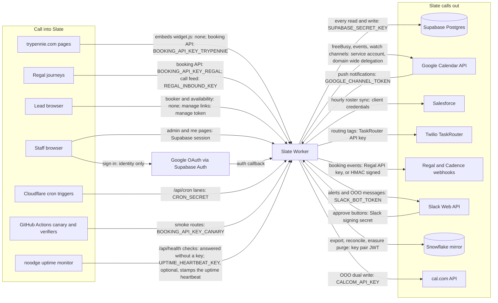
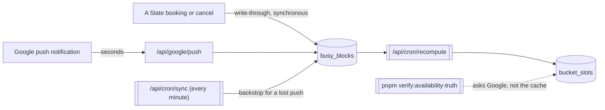

# Slate architecture at a glance

Two coarse diagrams, because the moving parts are hard to hold in your head from the
code alone: a booking touches a cache, Google, Postgres, an outbox and a webhook
subscriber, and the freshness of what a lead sees comes from three different writers.

Deeper detail lives in `CLAUDE.md` (architecture notes), `AGENTS.md` (the rules that
bite), `docs/crash-safe-booking-mutations.md` (the durable-intent pattern) and
`docs/adr/` (the decisions).

## System context: everything Slate talks to

Every external system, with the direction of each call and the credential that
authenticates it (#3131). An arrow points from the caller to the system called, so
an arrow INTO Slate is a route somebody else can reach, and its credential is one of
the rows in `docs/api.md`, ["Credentials and auth models"](./api.md#credentials-and-auth-models).
An arrow OUT of Slate is a credential Slate holds as a Worker secret (DEPLOY.md
section 2b).

Three things the picture does not say, so nobody reads them into it:

- **Calendar access is never the staff member's own Google sign in.** Sign in asks
  for identity only; every calendar read and write is the service account
  impersonating the agent through domain wide delegation (#1046).
- **Regal is on both sides.** Its journeys call Slate's booking API with Regal's own
  key, and Slate posts booking events to Regal's webhook endpoint with a different
  credential held on the `webhook_endpoints` row.
- **The cal.com arrow retires at cutover (#65).** It exists for the out of office
  dual write while both systems are live.

## Booking and availability

The read path is deliberately free of Google. The one live Google call a lead's
request makes is at confirm, which is what turns a stale cache into a slower booking
rather than a double booking (ADR 0003).

The three gates a bookable time must pass, in one shared predicate, are the org's
business hours, then the agent's working hours, then their calendar. The org window
is applied at READ time as well, so narrowing the hours lands on the next request
rather than the next recompute.

A fourth gate belongs to the LEAD, not the availability (#2310): a call may only start
from 08:00 to before 20:00 in the lead's own zone. It is judged in that zone, never
intersected with the org or agent windows, and it is not in the shared cache, because
every lead reads the same cached list. The shared slot picker filters what it shows,
and the booking layer refuses an outside start at confirm and on every reschedule.

## Keeping the cache fresh, and the lanes that do it

Three writers keep `busy_blocks` and `bucket_slots` current, and they are layered on
purpose: the fast one is not trusted to be reliable, and the reliable one is not fast.

The every-minute trigger drives four lanes (`sync`, `recompute`, `outbox`,
`selfheal`). Since #3693 each one is sent over the Worker's binding to itself and runs
as its own placed invocation near the database (an explicit placement hint pinned to
the database's region, `aws:us-west-2`, not Smart Placement, which never moved them),
because placement never moves a `scheduled()` handler; a lane that falls back runs in process and shares the cron's
invocation, which is why per-lane subrequest cost still matters. The
full lane list is in `docs/api.md`, and the platform ceilings are in
`docs/cloudflare-platform-notes.md`.

Every lane stamps a heartbeat, and a watchdog pages when one goes quiet, because a
lane that has stopped running looks exactly like a lane with nothing to do. Three
detectors carry a second stamp for when they last reached a MEASURED verdict, since a
fail-safe detector that reports "could not check" renders identically to one finding
nothing wrong (#1394).
